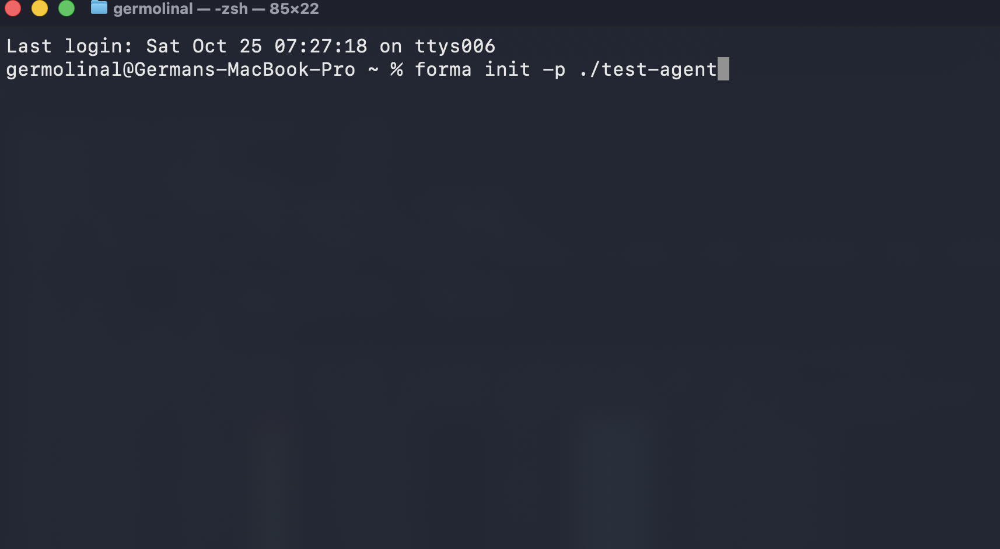
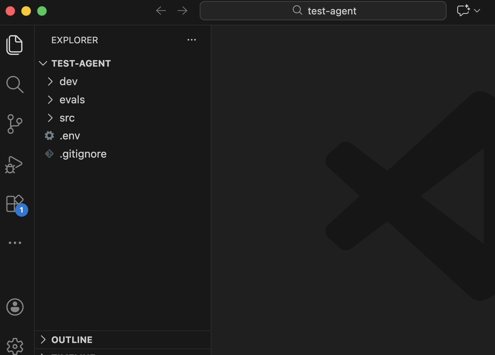
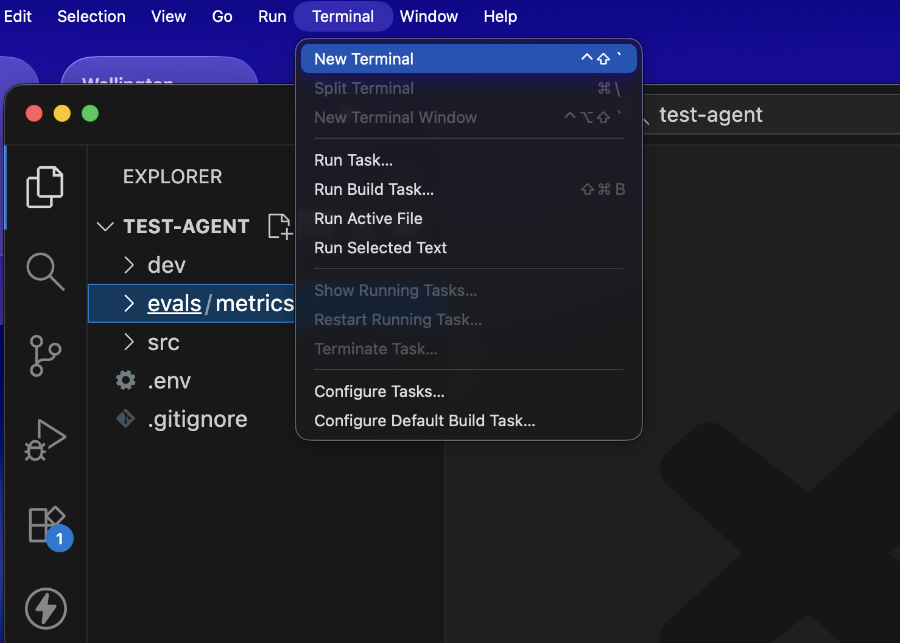

# Dory - Your first Forma agent

Welcome to the first true Forma tutorial! While very introductory, it is crucial, as it shows the main ways in which Forma was meant to be used. So, let's get started.


## 1. Create a new agent

The first thing you need to do is to open the a Terminal window, go to wherever you want to place your project, and write:

```sh
# Create a new directory called 'test-agent' and set up with a 
# convenient structure for a Forma agent

cd ~/Documents # or wherever else
forma init -p ./test-agent
```

Your terminal should look like this:



> **✅ Check progress**: this should have created a directory called `test-agent`

## 2. Open the `test-agent` directory in a text editor

Open the `test-agent` directory in a text editor. It should look somehow like the image below (that image uses VSCode).



Let's see what is in there

| directory/file              | purpose                                                                                                                       |
| --------------------------- | ----------------------------------------------------------------------------------------------------------------------------- |
| `src`                       | Contains the actual definition of your agent, like tools, prompts, and more.                                                  |
| `evals`                     | Contains the personas, datasets and metrics used to run [Evaluations](../documentation/evals.md) for this agent               |
| `dev`                       | We will discuss this one later. It has to do with emulation of other services                                                 |
| `runtime.yaml`              | Information regarding the [runtime](../reference_docs/auto-formaruntime.md) (i.e., how clients talk to your agent, and where conversations are kept) |
| `.env`                      | This is the file where you will store configuration and secret variables, like API Keys and the URL of databases              |
| `.gitignore`                | The file that defines what should be shared with the other people in your team, or not (e.g., you can have your own API Keys) |
| `README.md`                 | A short guide to the project, with the commands you will use the most                                                         |
| `agent-dev-guidelines.md`   | Longer guidelines on how to develop and evaluate Forma agents. (They are also useful for coding assistants.)                  |


The contents of each of these should be relatively self-explanatory. If not, we will dive deeper in each of these in later tutorials.

## 3. Chat with your agent

As you can imagine, `forma init` gives you a functional (although, pretty basic) AI Agent. So, let's try it, and we can improve it later.

Dory uses [Ollama](https://ollama.com), which runs LLMs on your own computer. So, before chatting, make sure Ollama is running and has the model Dory uses:

```sh
ollama serve # Unless it is already running
ollama pull llama3.1:8b
```

Then, you need to open a terminal window within your text editor:



And then, you need to use the following command:

```sh
forma dev
```

You should see something like this:

```text
______________________________________________________
| Chat with 'dory' at http://127.0.0.1:8080
------------------------------------------------------
```

Open [http://127.0.0.1:8080](http://127.0.0.1:8080) in your browser, and a chat should open. Try saying something, like 'hi' or whatever you want! (You can stop the server by pressing `CTRL+C` in the terminal)

> **📌 Note**: The port is defined by the `PORT` variable in your `.env` file. Change it if `8080` is already taken in your computer.

> **✅ Check progress**: Does the AI Agent respond?

## 4. Edit your agent

**Without stopping `forma dev`**, go to the `src/prompts/agent_prompt.md` file. Try changing the prompt to the following:

```
You are a passive agressive assistant
```

Save this file. You should see a message in the terminal indicating that a file was modified, and the agent will be reloaded.

Then, if you say something, its personality should have changed from a helpful assistant to a passive aggressive one.

## 5. Have a look at the `agent.yaml` file

If you go to the `src/agent.yaml` file, you can see how we are defining this agent. Leaving the comments and the evaluations aside (we will talk about these [later](./evaluations.md)), it looks like this:

```yaml
id: dory
name: Dory, a helpful assistant
description: A helpful assistant that helps you with your daily tasks.

start:
  nodes:
    - id: reply
      llm:
        provider: ollama
      system_prompt: $/prompts/agent_prompt.md
```

Let's see what we have got here:

| Element         | Purpose                                                                                                                              |
| --------------- | ------------------------------------------------------------------------------------------------------------------------------------ |
| `id`            | This is useful for identifying your agent in traces, logs and other situations.                                                      |
| `name`          | A human-readable name for your agent                                                                                                 |
| `description`   | A short description of what your agent does                                                                                          |
| `start`         | The main [Workflow](../documentation/building-blocks.md#3-workflows) of the agent, the one that receives the clients' messages       |
| `nodes`         | The `start` workflow contains a single [Node](../documentation/building-blocks.md#2-nodes), called `reply`                           |
| `llm`           | The only node here uses Ollama as its LLM                                                                                            |
| `system_prompt` | The system prompt stored in `./src/prompts/agent_prompt.md` (the one you edited). The `$` means "read this file, relative to this one" |

> **📌 Note**: `$` references are only read in YAML (or JSON) files. A file read this way is used verbatim, so a `$/rules.md` written inside `agent_prompt.md` stays as literal text in the prompt. This is on purpose: Forma does not support [reusable blocks of instructions](./templates.md#-why-not-reuse-blocks-of-instructions).

## 6. Check what you built

Forma fills in a lot of things for you. For example, we never said which Ollama model Dory should use. To see what your agent actually became, run:

```sh
forma expand
```

This prints your agent with every `$file` reference replaced by the contents of that file, and every field you did not write filled with its default value. For example:

```yaml
id: dory
name: Dory, a helpful assistant
description: A helpful assistant that helps you with your daily tasks.
start:
  id: we957746-7997-4254-a972-fb1134ced1b9
  nodes:
  - id: reply
    llm:
      provider: ollama
      model: llama3.1:8b
    system_prompt: You are a passive agressive assistant
    max_iterations: 10
    ...
```

It is worth running `forma expand` after editing your `agent.yaml` file. It is the quickest way to find mistakes, as Forma rejects fields it does not recognise. For example, a misspelled `system_promt` gives:

```text
Runtime Error: start.nodes[0]: unknown field `system_promt`, expected one of `id`, `llm`, `system_prompt`, ...
```

Add `-c` (`forma expand -c`) to also compile the agent, which checks the tools and LLM settings as well.


## 📌 A note about memory

If you talked to Dory for a while, you might have noticed that it has [contextual memory](../documentation/memory.md#short-term-or-contextual-memory). That is to say, it can remember and revisit your previous messages to understand the dialog.

> **Note**: Forma Agents are **stateless**, meaning that they do not keep conversation history or any other kind of state themselves. This has many benefits when putting them in production, but it also means that an external storage must be in charge of keeping track of the conversation history, and sending it to the agent.

In the [next section](./contextual-memory.md) we will explore where Dory keeps its memories, and what this means once you deploy it.
