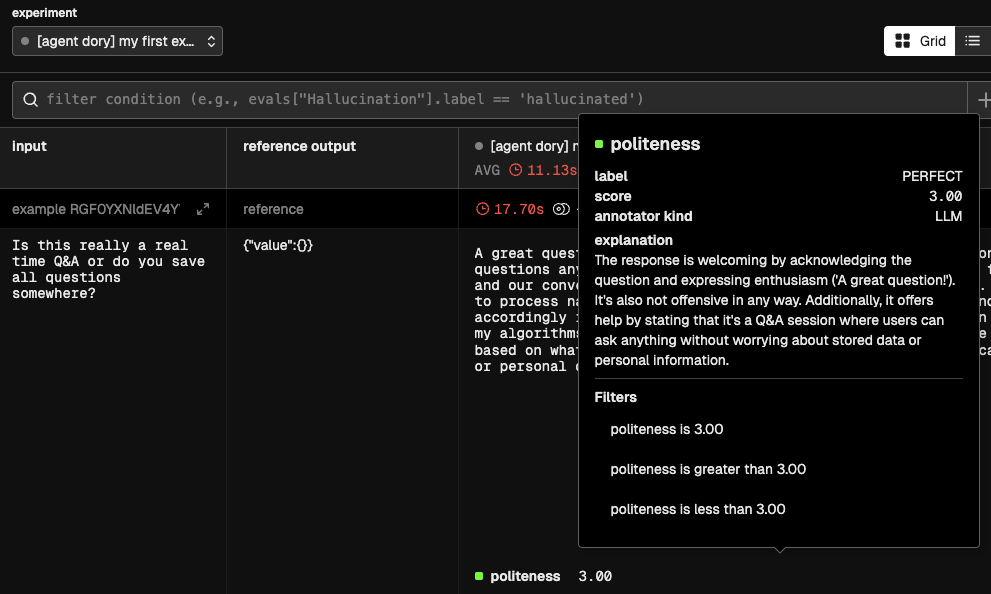

# Offline Evaluations


As you might have read in the [Evaluations explanation](../documentation/evals.md), evaluations are fundamental for developing trustworthy and reliable AI Agents. Forma encourages people to run evaluations often. This tutorial aims to explain the workflow that Forma has envisioned for Evaluations.

In simple terms, an evaluation is a straightforward concept:

1. You have a sample question
2. You ask that question to your agent
3. You then use some metric or rubric to decide whether the answer is good enough or not, and why (this will sometimes require having a sample output)

Forma can help us with these three steps.

> **Note**: *Offline* evaluations refer to the evaluations **run before** deploying an AI Agent. They are different from *online* or *continuous* evaluation in that they can use pre-established datasets to compare actual vs expected answers. Continuous evaluation is still in development.

## 1. Use *Personas* to generate sample questions

For our current goal, *Persona* is no more than a roleplaying LLM. We tell an LLM "Pretend to be...", and they will send messages as if this was the case. We can leverage this for generating sample data.

AI Agents can be surprisingly good testers of other AI Agents as many of their flaws—like hallucinations and potential offensiveness—are not an issue when generating data. After all, users are allowed to be way more offensive and clueless than an AI Agent (because if the user does not understand quickly what the App is about, we blame the designer, not the user).

So, let's explore our first *Persona*. Open the file `./evals/personas/wanderer.yaml`

```yaml
llm:
  provider: ollama
prompt: Imagine you are a person who just landed on a
  website, and this website looks just like a chat interface.
  It is an empty canvas with a textbar saying "ask me anything"
  and a send button. What would you ask?
  Just send your question, not any other comment.
```

As you can tell, we are asking an LLM (ran by Ollama, in this case) to pretend to be a human who just happens to have landed in front of a Chatbot. What would your first reaction be?

So, we can generate some sample data by running:

```sh
forma tester -f wanderer.yaml -n 5
```

This writes the questions to `./evals/data/wanderer.json`, replacing whatever was there. (Use `-a append` to add the new questions to the existing ones instead.) You will notice that the `wanderer.json` file contains a list of objects which only have an `input` field. Each of these examples *can* also contain an `expected_output` field, which is exposed to metric templates as `{{expected_output}}` and may be used for contrasting it with the responses from your agent; and an `id`, which identifies the example in the reports. (Personas never write `expected_output`: datasets with reference answers are written by hand.)

## 2. Check that Forma can see the dataset

Datasets live in `./evals/data`, which is exactly where `forma tester` just left ours. So there is nothing to upload—Forma reads them straight from there:

```sh
forma dataset-list
```

```text
# wanderer (len=5 | id=wanderer)

A dataset by Persona 'wanderer'
```

If you wrote a dataset by hand somewhere else, `forma dataset-upload` copies it into the store:

```sh
forma dataset-upload -f ~/some/other/place/wanderer.json
```

> 📌 **Note** that datasets and results can also be kept in [Arize Phoenix](https://arize.com/docs/phoenix)—the same service we used in the [previous tutorial](./dory-traces.md)—instead of the filesystem. Add `--platform phoenix` to any of these commands, or set `FORMA_EVAL_PLATFORM=phoenix`, once the service is running:
>
> ```sh
> # You need to have docker compose installed
> docker compose -f ./dev/docker-compose.yaml up
> ```

## 3. Test your agent with that dataset

Before using our `wanderer` dataset for running evaluations, we need to define this evaluation. We can define evaluations in different [sub-components of the agent](../documentation/building-blocks.md) of the agent in order to perform more focused assessments.

In this case, we will evaluate the agent itself. This comes out of the box when you run `forma init`.

```yaml
# Define evaluations down here
evals:
  - dataset: wanderer
    metrics:
      - id: politeness
        template: $../evals/metrics/politeness.md
        judge:
          provider: ollama
```

The `id` of the metric is the name it will have in every report.

You can go and check the `politeness.md` file, and you will notice that it uses the same templating system we were using earlier (see [below](#what-is-happening-under-the-hood) to learn about the valid fields for evaluation templates).

With this in place, we can now run:

```sh
forma eval -a -e "my first experiment"
```

Use `forma eval --list` to see evaluable targets, `--dry-run` to inspect the
selection without running it, `-d DATASET` to select one or more datasets, and
`-m N` to use only the first N examples from each selected dataset. Add
`--random --seed SEED` for a reproducible sub-sample. All of these are explained
in [More on Evals](./unit-evals.md).

The results are written to `./evals/results`, as they are produced:

```text
evals/results/
  README.md                                  <- every evaluation you have ever run
  2026-08-16_140322_my-first-experiment/
    REPORT.md                                <- what happened in this one
    session.json
    agent-dory/
      experiment.json                        <- every answer, in full
```

Open `REPORT.md`. It opens with a *Scores* table—one row per evaluated element, one column per metric:

```markdown
| Callable | Runs | Failed | politeness |
| --- | ---: | ---: | ---: |
| agent `dory` | 5 | 0 | 2.40 |
```

Each score there is the mean of that metric over every dataset it was used on, so a regression on one dataset can be hidden by an improvement on another. The *Breakdown* follows it, splitting the same numbers one dataset at a time. This is where a regression on one dataset shows up instead of being cancelled by an improvement on another:

```markdown
### agent `dory`

| Dataset | Runs | Failed | Metric | Mean | Required | Range | Labels | Warning |
| --- | ---: | ---: | --- | ---: | ---: | --- | --- | --- |
| `wanderer` | 5 | 0 | politeness | 2.40 | — | 1 – 3 | PERFECT x3, OK x1, BAD x1 | — |
```

After that, the report goes through the examples one by one—worst first—showing what was asked, what your agent answered, and what the judge made of it. `Failed` counts agent failures; a judgement/template error may be printed separately and leave the metric mean as `—`, so do not interpret `Failed: 0` as proof that every judgement succeeded.

`README.md` is laid out the same way, with a `When` and an `Experiment` column added to each table: one row per element per evaluation, most recent first, which is how you tell whether a change to your agent made things better or worse.

> 📌 **Note** that if you are keeping results in Phoenix (with `--platform phoenix`), they show up in its UI instead, at [http://localhost:6006/](http://localhost:6006/):
>
> 

# ❓What is happening under the hood?

1. The first step is to ask your Agent, Node or Workflow that will be evaluated to produce an answer. This is called the `actual_output`.
2. Having generated the `actual_output`, the metric template will be rendered. This template can contain only three fields:   
   * `actual_output` - Which will be replaced with the answer of the agent, node or other.
   * `input` - Which will be replaced by the input, extracted from the dataset.
   * `expected_output` - An optional value extracted from the example's `expected_output` field.
3. This new rendered template will be sent to an LLM of your choice, which will be asked to generate:
   * `label` - A single-word verbal equivalent of the score (e.g., 'Good', 'Bad', 'Hallucination'). Base this value on the instructions provided
   * `score` - The numerical value reflecting the quality of the evaluation, assigned as per the instructions
   * `explanation` - A verbal explanation for the score and labels given