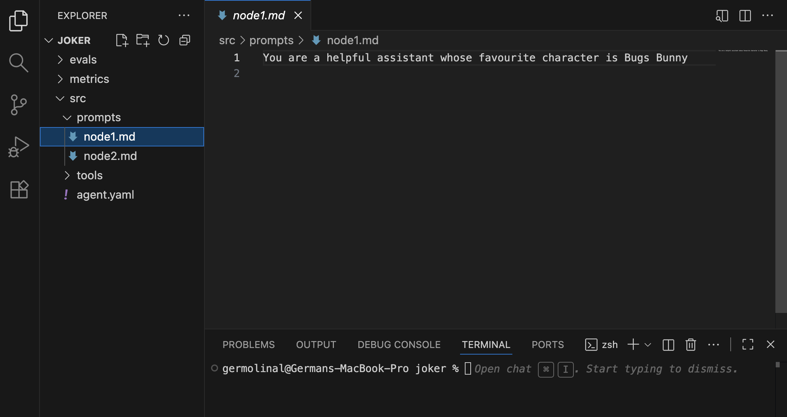

# Getting started

So you decided to get started with Forma! That is great! The next few sections will show you how to get started and develop your first AI Agent with memory and tools.

You might remember from the [introduction](../intro.md#6-integrate-it-with-your-existing-infrastructure) that Forma **does not come with the batteries included**. This means that in order to develop with Forma you will need to install and get familiar with several (although, very common) developer tools:

1. **A Code or Text editor** - Necessary to define the AI Agents
2. **The Forma CLI** - Necessary to run, test, evaluate, and deploy AI Agents
3. **An LLM provider** - The agent created by `forma init` uses [Ollama](https://ollama.com), which runs on your laptop and needs no API key
4. **Docker (or similar)** - To run services like observability platforms, etc.
5. **`git`** - For managing different versions and changes in an auditable and secure manner.
6. **Other emulators** - Depending on how you want to deploy your agent, you might need to emulate other cloud services.

> **Note** - We know this adds frictions, and yet it is a deliberate choice. The reason is that, even if it makes it hard to get started, it really ensures consistency and flexibility... And also, if you are getting into this domain, learning these tools will be necessary.


## You develop Forma agents in a text editor

Forma agents are fully described using text files and, therefore, it is only natural that **your main development tool will be a code/text editor**. The advantage of a good code/text editor is that it will give you (unsurprisingly) excellent text editing capabilities, and good integration with tools like [version control](https://en.wikipedia.org/wiki/Version_control) and the Forma CLI. Additionally, a good editor will be able to highlight the syntax of the different file formats we will be using (`yaml`, `markdown`, `json`).

> **Note** - If you aren't sure what code editor to choose, [VS Code](https://code.visualstudio.com/) might be a good fit. If you have strong opinions about this—and many people do—use whatever suits you.




## You interact with Forma agents using the Forma CLI

The Forma CLI is the main tool you will use during development. Among other things, it will help you:

* **Start** new projects (`forma init`)
* **Chat with your agent** in the browser, with hot reloading (`forma dev`)
* **Run a development server** that speaks the same protocol as production (`forma serve`)
* **Check what you built**, with every file reference resolved (`forma expand`)
* **Evaluate your agent** to ensure quality and guide your prompting (`forma eval`)
* **Create a synthetic evaluation dataset** using a persona (`forma tester`)
* **Manage datasets** (`forma dataset-list`, `forma dataset-upload`, `forma dataset-download`)
* **Connect to MCP servers** that require you to log in (`forma login`)

Read more details on the [how to define your first agent](./dory.md) section. You can always check what a command does by running `forma help <command>`.

### Installing the Forma CLI

Download it from the [latest release](https://github.com/germolinal/forma/releases/latest), for Linux or macOS:

```sh
# Pick your computer: aarch64-apple-darwin (Apple Silicon), x86_64-apple-darwin (Intel Mac),
# x86_64-unknown-linux-gnu or aarch64-unknown-linux-gnu
TARGET=aarch64-apple-darwin
curl -sL https://github.com/germolinal/forma/releases/latest/download/forma-$TARGET.tar.gz | tar -xz
sudo mv forma-$TARGET/forma /usr/local/bin/
forma --version
```

> **📌 Note**: The Linux binaries need glibc 2.35 or newer (e.g., Ubuntu 22.04, Debian 12). The macOS ones are not signed by Apple yet: downloaded with `curl` as above they run, but one downloaded with a browser is blocked until you run `xattr -d com.apple.quarantine forma`.

You can also install it from the source code, using [Rust](https://www.rust-lang.org/tools/install):

```sh
# From within the forma directory of the repository
cargo install --path . --bin forma
```

And there is an image with the CLI, for pipelines (e.g., to run evaluations in CI): `ghcr.io/germolinal/forma-cli`.


### Design of the Forma CLI

The Forma CLI has been designed to be simple, quick, and easy to learn. A key element of this is that it is somehow opinionated... but we try to make it configurable.

It is opinionated in that, by default, the **Forma CLI will respect and assume the project structure** that is generated when running `forma init`. This means, for instance, that within the root directory, you should find a `src` directory containing your agent definition, an `evals` directory with evaluation data, and so on. 

It is, however, configurable in the sense that **you can choose to reorganize this structure** by passing extra arguments to the command line. For instance, `forma dev`, `forma serve` and `forma expand` accept a `-p` argument indicating the directory where the agent is defined, and a `-a` argument with the name of the agent file within it. Not providing them defaults to `./src/agent.yaml`, which is our recommended structure, but you can change it. (`forma eval` takes the whole path at once, using `-f`.)

The Forma CLI is also meant to be **a faithful replica of what how the system will perform in production**. As such, the development servers (`forma serve` and `forma dev`) run the exact same agent code as the production server. The main differences are that they reload your agent every time you save a file, and that they keep the conversations in files (within a `./forma-db` directory) instead of a database, so there is nothing to set up. Check the [Deployment](./deployment.md) section to learn what changes when you go to production.


## You use Docker (or similar) to emulate services during development

Forma agents are meant to be a part of a more complex system. Containers—which can be ran using Docker, or Podman or other alternatives—help you run services locally. This means you can simulate and test how your AI Agent would interact with the rest of the system (e.g., authentication, APIs, Databases, etc.).

The project created by `forma init` includes a `dev/docker-compose.yaml` file with [Arize Phoenix](https://phoenix.arize.com/), which we use to observe what the agent is doing (more on that in the [Observability tutorial](./dory-traces.md)). Docker is not needed to chat with your agent or to evaluate it.
